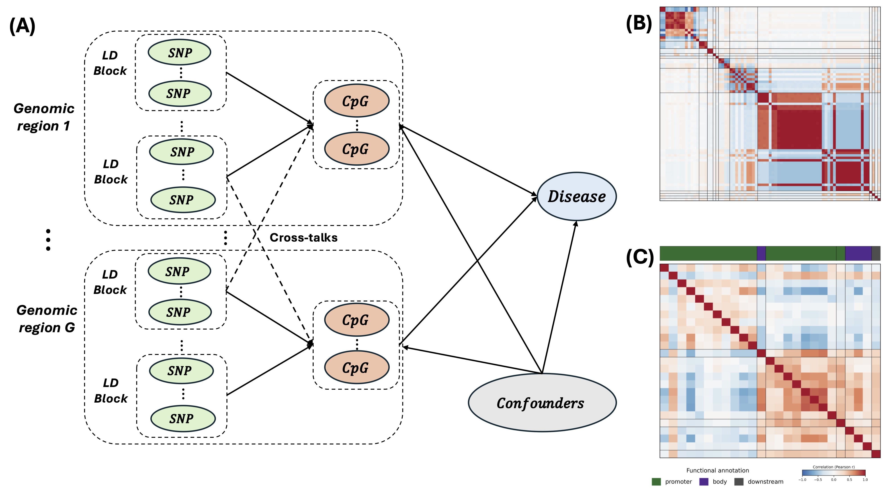

MR-G2G

This R code implements MR-G2G, a two-stage Mendelian randomization framework for estimating the causal effects of CpG methylation sites on a disease outcome, using SNP genotypes as instruments. It exploits the gene and region structure of the data: SNPs are grouped into linkage-disequilibrium (LD) blocks and CpG sites into regions within genes, and both groupings are built into the instrument-selection penalty.
It supports simulation of correlated genotype, methylation, confounder, and outcome data, cross-validated tuning of the Stage 1 penalty, Stage 2 causal effect estimation with several estimators, and a regional Wald test for which CpG regions affect the outcome. The current release covers individual-level data with a continuous outcome, for a single gene or multiple genes.




### `simulate_mrg2g_single_gene()` and `simulate_mrg2g_example()`
Generate synthetic genotype (`Z`), methylation (`X`), confounder (`U`), and outcome (`y`) data. `simulate_mrg2g_single_gene()` simulates one gene with 100 SNPs and two CpG regions of 10 sites each, the first causal and the second null. `simulate_mrg2g_example()` simulates three genes (300 SNPs, 50 CpG sites, four CpG regions) with three confounders and cross-gene (trans) SNP effects; each gene follows a different instrument design (master-SNP, LD-group, and mixed).
Both functions let the user set the sample size, signal strength, noise level, methylation correlation structure (`"Simple"` or `"AR1"`), and whether the returned data are standardized.
**Main output:** matrices `Z`, `X`, `U`, and outcome `y`; the true parameters in `truth` (SNP–CpG effects `B`, causal effects `theta`, confounder effects `gamma`, and their standardized versions); and the block layout in `design`.

### `make_gene_structure()`
Builds the gene structure from the LD block sizes and CpG region sizes of each gene, recording which SNP columns and CpG columns belong to which gene.
**Main output:** a list with one entry per gene, giving its SNP range, CpG range, LD blocks, and CpG regions.

### `mrg2g_setup()`
Checks and packages the data for fitting. It verifies that `Z`, `X`, `y`, and `U` have matching dimensions and agree with the gene structure, names the CpG regions, and centers and scales all inputs by default.
**Main output:** an `mrg2g_data` object passed to the tuning and fitting functions.

### `mrg2g_tune()`
Selects the Stage 1 penalty parameters for each gene by K-fold cross-validation of how well Z predicts X; the outcome is never used. For each gene, the penalty weights (`a1`, `a2`) are chosen at the cross-validation minimum and `lambda` by the one-standard-error rule within that structure. For multiple genes, `lambda_trans` is then chosen the same way with the cis parameters fixed.
**Main output:** per-gene `lambda`, `a1`, and `a2`, `lambda_trans`, and the full cross-validation tables.

### `mrg2g_fit()`
Fits the two-stage model.
In Stage 1, it estimates the sparse SNP-to-CpG coefficient matrix `B` with a three-part penalty, solved by proximal gradient descent:

```text
min_B  (1/2)*||X - Z*B||_F^2
       + *lambda*[ a1*||B||_1
                    + a2*sum over LD blocks l and CpGs k of sqrt(p_l)*||B[l, k]||_2
                    + a3*sum over SNPs j and CpG regions c of sqrt(h_c)*||B[j, c]||_2 ],
a3 = 1 - a1 - a2.
```
Here `a1` sets element-wise sparsity, `a2` the LD-block grouping of SNPs, and `a3` the regional grouping of CpG sites; `lambda` is on a per-observation scale. With multiple genes, each gene gets its own `lambda`, `a1`, and `a2`: cis blocks are estimated first, trans effects are then estimated with a lasso penalty `lambda_trans`, and the cis blocks are refit.
In Stage 2, the selected instruments give fitted methylation values, and the outcome is regressed on them (and on `U`, unpenalized) with elastic net (default), lasso, OLS, or scaled group lasso.

```r
source("MRG2G.R")
source("simulate_g2g_data.R")

d <- simulate_mrg2g_example(n = 300, signal = 0.25, cov_structure = "AR1", seed = 1)

gs  <- make_gene_structure(
  ld_blocks = lapply(d$design$gene_structure, `[[`, "ld_blocks"),
  cg_blocks = lapply(d$design$gene_structure, `[[`, "cg_blocks"))
dat <- mrg2g_setup(Z = d$Z, X = d$X, y = d$y, U = d$U,
                   gene_structure = gs, region_names = d$design$block_names)

tn  <- mrg2g_tune(dat)
fit <- mrg2g_fit(dat, lambda = tn$lambda, a1 = tn$a1, a2 = tn$a2,
                 lambda_trans = tn$lambda_trans)

fit$estimates$en$theta
wt <- mrg2g_wald(fit, corrections = "bh")
```

**Main output:** the estimated `B_hat`; the selected instruments and CpG sites; the fitted methylation `X_hat`; and, for each Stage 2 estimator, the causal effects `theta` (on the standardized scale and, as `theta_raw`, the original scale) and confounder effects `gamma`.

### `mrg2g_wald()`
Tests whether each selected CpG region has a nonzero joint causal effect on the outcome. It uses a decorrelated-score Wald test: each region's fitted methylation is projected away from the other regions and the confounders, the outcome's partial residual is projected onto that space, and the statistic is compared to a chi-squared distribution. Initial estimates come from the scaled group lasso by default. P-values can be adjusted with Benjamini–Hochberg, Bonferroni, or both.
**Main output:** a data frame with one row per region: the number of selected sites, the Wald statistic, degrees of freedom, raw and adjusted p-values, and rejection decisions.

Requirements
===========
R packages `glmnet`, `MASS`, and `Matrix`. The base package `parallel` is used when `mrg2g_tune()` is run with `cores > 1` (Mac and Linux).

Example scripts
===========
- `single_gene_example.R`: one gene, no confounders.
- `multigene_example.R`: three genes and three confounders, tuned with `mrg2g_tune()`. Cross-validated tuning takes roughly 15 minutes on one core.

Output
===========
Typical output from the example scripts includes:
- `IVs_selected` and `methyls_selected`: the instruments and CpG sites kept in Stage 1;
- `region_names_sel`: the CpG regions with at least one selected site;
- `estimates`: Stage 2 causal effect estimates `theta` and confounder effects `gamma` for each estimator;
- `lambda`, `a1`, `a2`, and `lambda_trans`: the Stage 1 tuning parameters used;
- the regional Wald test table, with `wald_stat`, `df`, `pval_raw`, adjusted p-values (`padj_bh`, `padj_bonferroni`), and rejection indicators (`reject_bh`, `reject_bonferroni`).

For real data, the same workflow applies without the simulation step: supply `Z`, `X`, `y`, optional `U`, and the LD block and CpG region sizes for each gene.

